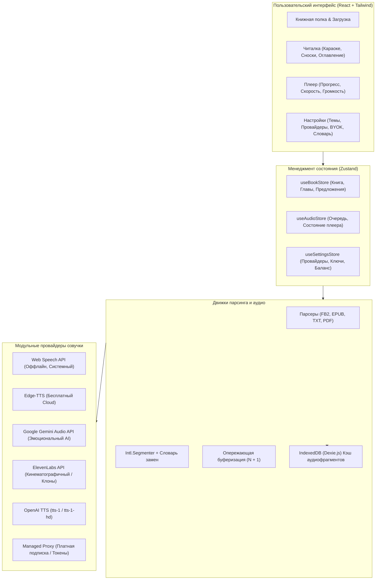

# AIBookReaderWeb — Архитектурная спецификация и план задач для «Секретаря»

**Версия документа:** 1.0.0  
**Целевая директория:** `F:\Projects\AIBookReaderWeb`  
**Платформы:** Web (PWA в браузере) + Desktop (Tauri v2: Windows, macOS, Linux)  
**Технологический стек:** React, Vite, TypeScript, Tailwind CSS, Lucide React, Zustand, Dexie.js (IndexedDB), Tauri v2.

---

## Архитектурный обзор системы



---

## Структура директорий проекта

```
F:\Projects\AIBookReaderWeb/
├── src/
│   ├── assets/               # Логотипы, иконки, системные стили
│   ├── components/
│   │   ├── reader/           # Компоненты читалки (BookView, SentenceSpan, ChapterDrawer)
│   │   ├── player/           # Аудиоплеер (ControlBar, SpeedSelector, BufferIndicator)
│   │   ├── library/          # Список книг, Drag-and-Drop зона импорта
│   │   └── settings/         # Модалки настройки API-ключей, словаря, баланса
│   ├── engine/
│   │   ├── parsers/          # fb2Parser.ts, epubParser.ts, txtParser.ts, pdfParser.ts
│   │   ├── tokenizer/        # sentenceTokenizer.ts, dictionaryReplacer.ts
│   │   ├── audio/            # audioQueue.ts, audioPlayer.ts, prebuffering.ts
│   │   └── providers/        # webSpeech.ts, edgeTts.ts, geminiTts.ts, elevenLabs.ts, openaiTts.ts
│   ├── store/                # Zustand хранилища: bookStore, audioStore, settingsStore
│   ├── storage/              # db.ts (Dexie.js схемы: книги, прогресс, кэш аудио)
│   ├── types/                # book.d.ts, audio.d.ts, tts.d.ts, settings.d.ts
│   ├── App.tsx               # Корневой маршрутизатор и лейаут
│   └── main.tsx              # Точка входа React
├── src-tauri/                # Конфигурация и Rust-код Tauri v2
├── public/                   # Статические манифесты и иконки PWA
├── package.json
├── tailwind.config.js
├── tsconfig.json
└── vite.config.ts
```

---

## Декомпозиция задач по фазам (Для заведения в «Секретарь»)

---

### ФАЗА 1: Ядро читалки и парсинг электронных книг

#### [TASK-1.1] Инициализация каркаса проекта и стилей
* **Роль:** `Frontend Core Engineer`
* **Цель:** Развернуть Vite + React 18/19 + TypeScript + Tailwind CSS с поддержкой PWA и базовой структуры папок.
* **Технические требования:**
  - Настроить `vite.config.ts`, `tailwind.config.js`, `tsconfig.json`.
  - Установить библиотеки: `lucide-react`, `zustand`, `dexie`, `clsx`, `tailwind-merge`.
  - Организовать базовую дизайн-систему: поддержка светлой, темной, сепия и OLED-черной тем оформления.
* **Критерии приемки:**
  1. `npm run dev` успешно стартует без ошибок.
  2. Переключение тем оформления работает через CSS-переменные или класс `dark`.
  3. Готова базовая оболочка приложения с верхним баром и областью контента.

---

#### [TASK-1.2] Клиентские парсеры книг (FB2, EPUB, TXT)
* **Роль:** `Parser & Document Specialist`
* **Цель:** Реализовать парсинг файлов электронных книг на клиенте без передачи файлов на сервер.
* **Технические требования:**
  - **FB2-парсер (`fb2Parser.ts`)**: Использовать нативный браузерный `DOMParser`. Извлекать: метаданные книги (автор, название, обложка из base64), структуру разделов/глав, текст с параграфами, сноски (`<a type="note">`).
  - **EPUB-парсер (`epubParser.ts`)**: Использовать `epubjs` или чистый распаковщик архива с извлечением TOC (оглавления) и HTML-секций.
  - **TXT-парсер (`txtParser.ts`)**: Разбивка по параграфам с авто-детектированием заголовков глав.
  - Унифицированный интерфейс выхода:
    ```typescript
    interface ParsedBook {
      id: string;
      title: string;
      author: string;
      coverUrl?: string;
      chapters: Chapter[];
      notes: Record<string, string>; // Сноски и комментарии
    }
    interface Chapter {
      id: string;
      title: string;
      contentHtml: string;
    }
    ```
* **Критерии приемки:**
  1. Пользователь может перетащить (drag-and-drop) файл `.fb2`, `.epub` или `.txt`.
  2. Книга корректно парсится, извлекаются оглавление и сноски.
  3. Всплывающее окно клика по сноске показывает текст примечания.

---

#### [TASK-1.3] Токенизатор предложений и словарь замен
* **Роль:** `NLP & Text Processing Engineer`
* **Цель:** Разбить текст глав на массив предложений с точными индексами и применить правила произношения.
* **Технические требования:**
  - Использовать нативный JavaScript `Intl.Segmenter` (`granularity: 'sentence'`) для языко-зависимой и устойчивой к сокращениям сегментации.
  - Реализовать `dictionaryReplacer.ts`:
    - Пользовательский словарь замен (формат: `слово : произношение` или `regex : замена`).
    - Исправление бага старого проекта: замены должны применяться последовательно и сохранять оригинальный регистр окружающего текста.
    - Автоматическая замена частых сокращений ("т.е." -> "то есть", "и т.д." -> "и так далее").
* **Критерии приемки:**
  1. Главы книги разбиваются на массив `SentenceItem { id: number; rawText: string; speechText: string; startIndex: number; endIndex: number }`.
  2. Словарь замен корректно трансформирует `speechText` без поломки `rawText` (то, что отображается на экране).

---

#### [TASK-1.4] Компонент читалки: Караоке-подсветка и автоскролл
* **Роль:** `UI/UX Engineer`
* **Цель:** Отобразить текст книги с возможностью кликабельного выбора любого предложения и плавным автоскроллом при чтении.
* **Технические требования:**
  - Каждое предложение оборачивается в интерактивный `<span>` с атрибутом `data-sentence-id`.
  - Текущее читаемое предложение подсвечивается мягким акцентным цветом.
  - При смене предложения активный элемент плавно центрируется на экране:
    `element.scrollIntoView({ behavior: 'smooth', block: 'center' })`.
  - Чекбокс «Автоскролл» (вкл/выкл) в быстрых настройках.
  - Изменение размера шрифта, межстрочного интервала и шрифта (Serif / Sans-serif).
* **Критерии приемки:**
  1. Клик по любому предложению переключает текущий маркер чтения на него.
  2. При активном автоскролле экран плавно следует за чтением без рывков.

---

### ФАЗА 2: Аудио-конвейер, Кэш и Провайдеры озвучки

#### [TASK-2.1] Модульная архитектура TTS-провайдеров
* **Роль:** `Audio & Architecture Engineer`
* **Цель:** Спроектировать унифицированный интерфейс для интеграции любых голосовых движков.
* **Технические требования:**
  - Создать базовый интерфейс `ITTSProvider`:
    ```typescript
    export interface ITTSProvider {
      id: string;
      name: string;
      requiresApiKey: boolean;
      supportsVoiceCloning: boolean;
      getVoices(): Promise<VoiceOption[]>;
      synthesize(text: string, voiceId: string, options: SynthesisOptions): Promise<ArrayBuffer>;
    }
    ```
  - Реализовать провайдеры:
    1. **WebSpeechProvider**: Нативный `window.speechSynthesis` (0 затрат, работает оффлайн).
    2. **EdgeTTSProvider**: Бесплатный синтез через Edge API (высокое качество речи).
    3. **GeminiTTSProvider**: Синтез через Google Gemini API (эмоциональный стиль, возможность задавать характер).
    4. **OpenAITTSProvider**: Модели `tts-1` и `tts-1-hd`.
    5. **ElevenLabsProvider**: Премиальное кинематографическое чтение и клонированные голоса.
* **Критерии приемки:**
  1. Переключение провайдера в настройках мгновенно меняет доступные голоса.
  2. Ошибки сети или лимитов API возвращают типизированную ошибку с понятным описанием для пользователя.

---

#### [TASK-2.2] Опережающая буферизация (Lookahead Queue) и Аудиоплеер
* **Роль:** `Audio Pipeline Specialist`
* **Цель:** Обеспечить бесшовное прослушивание без пауз между предложениями.
* **Технические требования:**
  - Создать очередь предзагрузки: пока воспроизводится предложение $N$, движок в фоновом режиме запрашивает и подготавливает синтез для предложения $N+1$ (и опционально $N+2$).
  - Использовать `HTML5 Audio` / `Web Audio API` для мгновенного бесшовного перехода.
  - Поддержка паузы, продолжения, перемотки на $\pm 10$ секунд, перехода на следующее/предыдущее предложение.
  - Управление с клавиатуры (Пробел — Пауза/Старт, Стрелки — смена предложений).
* **Критерии приемки:**
  1. Задержка между окончанием звучания фразы $N$ и стартом фразы $N+1$ составляет менее 150 мс.
  2. При паузе/перемотке очередь корректно отменяет устаревшие фоновые запросы (через `AbortController`).

---

#### [TASK-2.3] Локальный кэш аудиофрагментов в IndexedDB (Dexie.js)
* **Роль:** `Storage & Offline Engineer`
* **Цель:** Исключить повторную оплату токенов и ускорить воспроизведение уже озвученных фрагментов.
* **Технические требования:**
  - Создать базу данных `AIBookReaderDB` на базе `Dexie.js`:
    ```typescript
    db.version(1).stores({
      books: 'id, title, author, lastReadChapterId, lastReadSentenceId',
      audioCache: '[bookId+sentenceId+voiceId], timestamp, blob'
    });
    ```
  - Перед отправкой запроса в TTS-провайдер проверять наличие записи в `audioCache`.
  - При наличии — возвращать кэшированный `Blob` за 0 мс.
  - Кнопка в настройках: «Очистить кэш книги» / «Размер кэша: X МБ».
* **Критерии приемки:**
  1. Повторный переход к ранее прослушанному предложению воспроизводится моментально без сетевого запроса.
  2. Кэш сохраняется между перезагрузками страницы.

---

#### [TASK-2.4] Модалка настроек провайдеров и режим BYOK (Bring Your Own Key)
* **Роль:** `Frontend Security & Settings Engineer`
* **Цель:** Позволить пользователям вводить свои личные API-ключи.
* **Технические требования:**
  - Поля ввода для ключей: Gemini API Key, OpenAI API Key, ElevenLabs API Key.
  - Кнопка «Проверить ключ» (делает пробный микро-запрос на 1 слово).
  - Безопасное сохранение ключей в `localStorage` (опционально зашифрованных локальным мастер-паролем).
  - Ссылки на получение ключей для удобства пользователя.
* **Критерии приемки:**
  1. Валидация ключа с индикатором статуса (зеленая галочка / сообщение об ошибке).
  2. Ключи никогда не передаются на внешние сервера, кроме официальных эндпоинтов API поставщика при прямом режиме (BYOK).

---

### ФАЗА 3: Десктоп-версия (Tauri v2) и Full Offline

#### [TASK-3.1] Интеграция Tauri v2 в проект
* **Роль:** `Desktop & Systems Engineer`
* **Цель:** Превратить веб-приложение в нативный кроссплатформенный десктоп.
* **Технические требования:**
  - Инициализировать `tauri-cli` в проекте (`npm run tauri init`).
  - Настроить `tauri.conf.json`: заголовок окна, минимальный размер (1024x700), кастомный тайтлбар или стандартные рамки окна.
  - Настроить плагины Tauri: `fs` (чтение файлов напрямую с диска), `dialog` (нативные диалоги выбора файлов книг), `store` (сохранение настроек).
* **Критерии приемки:**
  1. `npm run tauri dev` запускает нативное окно десктоп-приложения.
  2. Открытие книги через нативный проводник Windows/macOS работает плавно.

#### [TASK-3.2] Нативная ассоциация файлов и сборка релизных пакетов
* **Роль:** `DevOps & Release Engineer`
* **Цель:** Создать готовый установщик для конечных пользователей.
* **Технические требования:**
  - Настроить ассоциацию расширений `.fb2`, `.epub` с приложением (открытие книги по двойному клику в проводнике).
  - Собрать `.msi` и `.exe` (NSIS) инсталлятор под Windows.
  - Вес итогового дистрибутива должен составлять не более 15–20 МБ.
* **Критерии приемки:**
  1. Установщик инсталлирует приложение на чистую Windows без необходимости устанавливать Python, Node.js или другие зависимости.
  2. Приложение стартует за < 1 секунды.

---

### ФАЗА 4: Монетизация и встроенная генерация (Managed Proxy)

#### [TASK-4.1] Легкий шлюз монетизации (Backend Proxy)
* **Роль:** `Backend & Security Engineer`
* **Цель:** Позволить клиентам покупать символы и слушать книги без необходимости вводить личные API-ключи.
* **Технические требования:**
  - Стек: FastAPI (Python) или Cloudflare Workers / Go.
  - Модель данных: Пользователь, Баланс символов (Tokens/Characters), История генераций.
  - Эндпоинт `POST /api/v1/tts/stream`:
    - Проверяет баланс пользователя.
    - Проксирует запрос в Gemini Flash Audio или ElevenLabs с серверным мастер-ключом.
    - Списывает точное количество символов из баланса.
    - Отдает аудио-стрим клиенту.
* **Критерии приемки:**
  1. Мастер-ключи поставщиков полностью скрыты от клиента.
  2. Баланс строго декрементируется на число переданных символов.

#### [TASK-4.2] Интеграция платежей и баланс в интерфейсе
* **Роль:** `Fullstack & Billing Engineer`
* **Цель:** Реализовать покупку пакетов символов в 1 клик.
* **Технические требования:**
  - Виджет в UI читалки: `Баланс: 450 000 символов (~1 книга)`.
  - Модальное окно пополнения (пакеты: 200k, 1M, 3M символов).
  - Подключение платежного шлюза (ЮKassa / CloudPayments для РФ, Stripe для зарубежных пользователей).
* **Критерии приемки:**
  1. После успешной оплаты баланс в приложении мгновенно обновляется через WebSocket или webhook polling.
  2. Пользователь видит предупреждение, когда на счете остается менее 5 000 символов.

---

## Чеклист для передачи агентам в работу

| Фаза | Задача | Статус | Назначенный агент |
| :---: | :--- | :---: | :--- |
| **1** | [TASK-1.1] Инициализация Vite + React + TS + Tailwind | ✅ Выполнено | `Frontend Core Engineer` |
| **1** | [TASK-1.2] Клиентские парсеры книг (FB2, EPUB, TXT) | ✅ Выполнено | `Parser & Document Specialist` |
| **1** | [TASK-1.3] Токенизатор предложений и словарь замен | ✅ Выполнено | `NLP & Text Processing Engineer` |
| **1** | [TASK-1.4] Компонент читалки (Караоке и скролл) | ✅ Выполнено | `UI/UX Engineer` |
| **2** | [TASK-2.1] Модульная архитектура TTS-провайдеров | ✅ Выполнено | `Audio & Architecture Engineer` |
| **2** | [TASK-2.2] Lookahead Queue и аудиоплеер | ✅ Выполнено | `Audio Pipeline Specialist` |
| **2** | [TASK-2.3] Кэш аудиофрагментов в IndexedDB | ✅ Выполнено | `Storage & Offline Engineer` |
| **2** | [TASK-2.4] Модалка настроек и режим BYOK | ✅ Выполнено | `Frontend Security Engineer` |
| **3** | [TASK-3.1] Интеграция Tauri v2 | ✅ Выполнено | `Desktop & Systems Engineer` |
| **3** | [TASK-3.2] Нативная сборка (.exe / .msi) | ✅ Выполнено | `DevOps & Release Engineer` |
| **4** | [TASK-4.1] Backend Proxy и списание символов | ✅ Выполнено | `Backend & Security Engineer` |
| **4** | [TASK-4.2] Интеграция биллинга и UI баланса (ЮKassa) | ✅ Выполнено | `Fullstack & Billing Engineer` |
